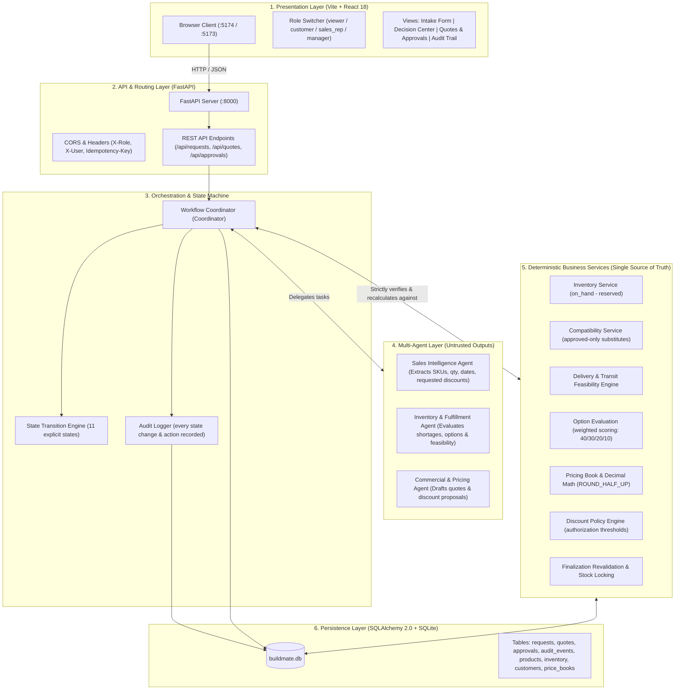
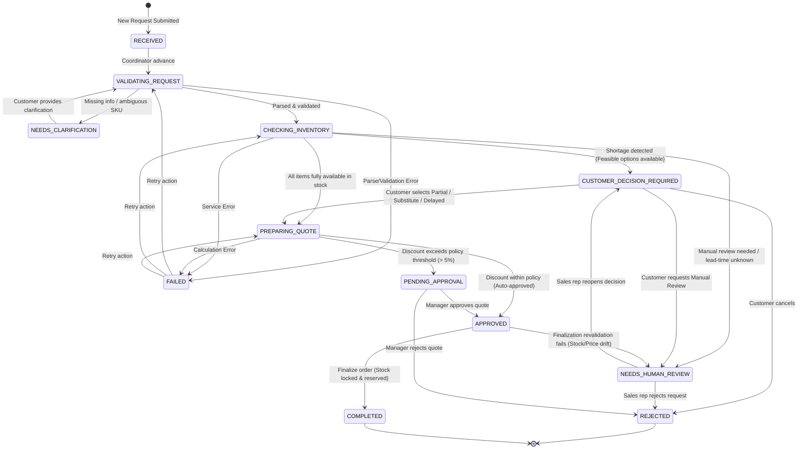
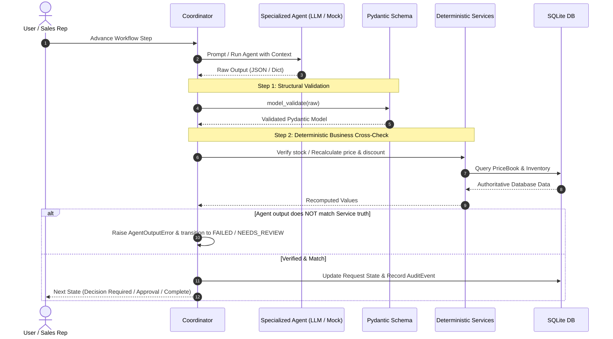

# BuildMate AI — System Architecture & Design Specification

BuildMate AI is a multi-agent workflow platform for construction supply ordering, fulfillment, and commercial quote generation. It coordinates autonomous agents with deterministic business validation, human-in-the-loop approvals, and full auditability.

---

## 1. High-Level System Architecture

---

## 2. Workflow State Machine Lifecycle

The coordinator operates on an explicit state machine. Each transition is validated against `TRANSITIONS` and audited:

---

## 3. Agent Execution & Validation Pattern

A fundamental design rule in BuildMate AI is that **Agent Output is Untrusted**. The AI suggests and parses; deterministic domain services verify and calculate:

---

## 4. Key Architectural Pillars

| Component | Responsibility | Guardrails & Design Rules |
| :--- | :--- | :--- |
| **Untrusted Agent Outputs** | Agents parse natural language, suggest substitution options, and propose discounts. | Agent calculations, inventory levels, and prices are **never trusted blindly**. They are strictly recomputed and verified against `services.py`. |
| **Deterministic Services** | Product catalog lookup, stock availability (`on_hand - reserved`), delivery lead times, option scoring, discount policy authorization. | Single source of truth. Handles edge cases gracefully (e.g. unknown supplier lead times mark option as `UNKNOWN`, not selectable). |
| **Explicit State Machine** | Controls allowable state transitions (`TRANSITIONS`). | Prevents illegal state jumps; allows retry from `FAILED` states. |
| **Full Audit Trail** | Tracks every state change, actor, and payload into `audit_events`. | Complete traceability for every decision, rejection, and authorization. |
| **Role-Based Access Control** | Header-simulated roles (`viewer`, `customer`, `sales_rep`, `manager`). | Approvals strictly require `manager`; finalization requires `sales_rep` or `manager`. |
| **Concurrency & Idempotency** | Prevents duplicate requests or quotes on network retry. | Deterministic hash keys (`idempotency_key`); finalization revalidates stock and pricing to prevent race conditions. |
