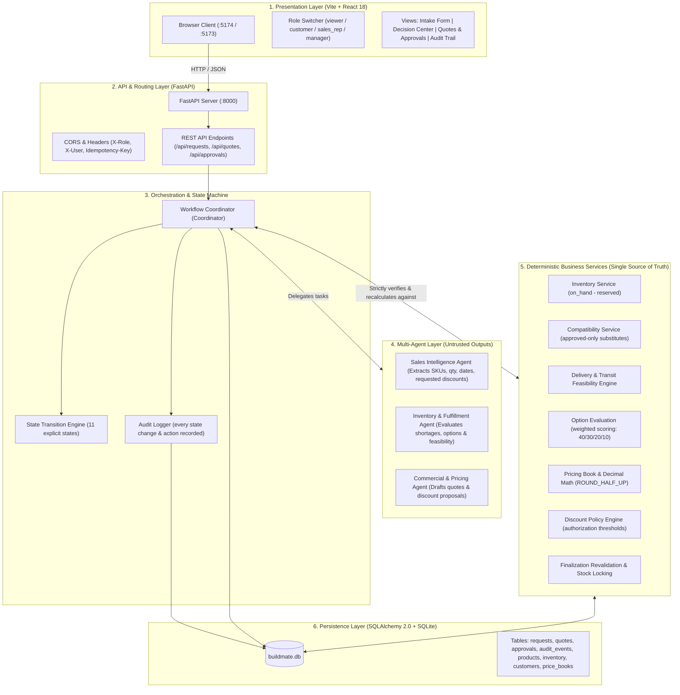
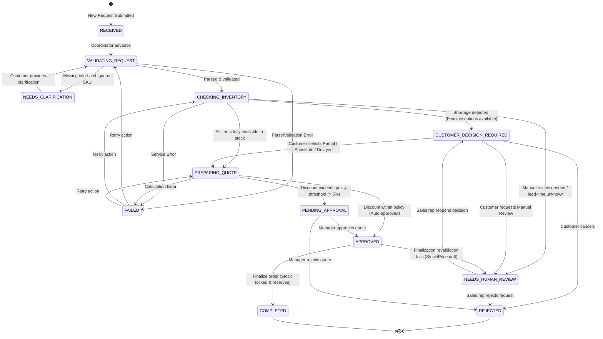
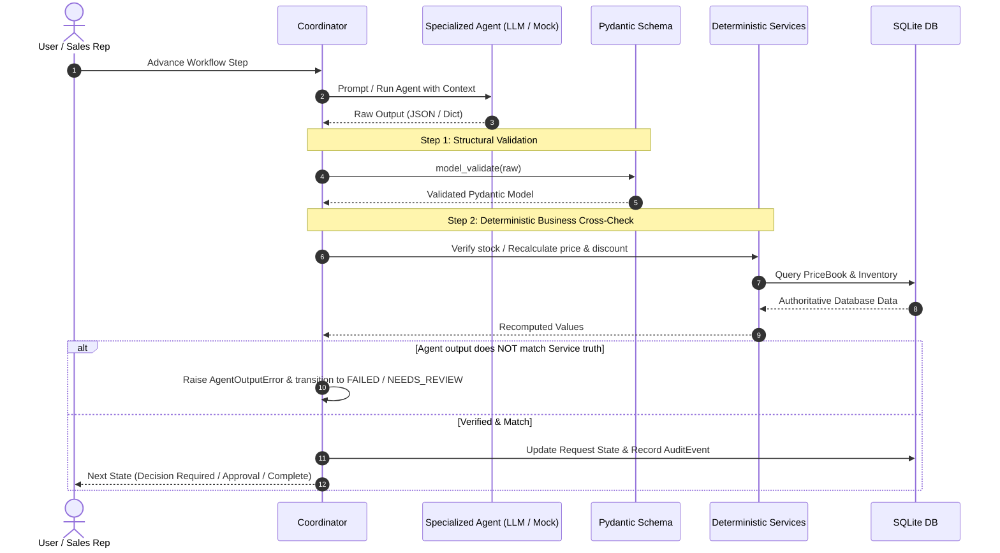

# BuildMate AI — multi-agent construction supply demo

One resumable workflow: **Sales Intelligence → Inventory & Fulfillment → Commercial & Quote**, coordinated by an explicit state machine with deterministic business services, human approvals and a full audit trail. Mock agents run with no API keys.

## Install & run
```bash
# backend (Python 3.11+)
cd backend && pip install -r requirements.txt
python -m app.seed                          # reproducible seed (drops/recreates buildmate.db)
uvicorn app.asgi:app --port 8000            # re-seeds on start; OpenAPI docs: http://localhost:8000/docs
# frontend (Node 18+), second terminal
cd frontend && npm install && npm run dev   # http://localhost:5173 (proxies /api to :8000)
```
## Tests
```bash
cd backend && python -m pytest -q     # 26 tests, business-outcome assertions
cd frontend && npm run build && npm test   # type-check + build + formatting unit test
```
## Demo (UI)
1. **New Request** → “Load demo request”, customer ABC Construction → *Submit*. Parsed: 500 cement, 200 drywall, 100 steel studs, Friday (2026-10-30 in tests), 10% requested.
2. **Decision Center** → steel stud shortage of 25 (75 available). Options: PARTIAL (feasible), SUBSTITUTE (approved heavy-gauge stud), DELAYED (**UNKNOWN**, no supplier date, not selectable), MANUAL_REVIEW. Requested subtotal $7,700.00. Choose PARTIAL → submit.
3. **Quotes & Approvals** → draft quote subtotal $7,537.50, 10% discount, total $6,783.75, status PENDING_APPROVAL. Switch role to `sales_rep`, click Approve → rejected (403, audited). Switch to `manager` → Approve.
4. Click **Finalize** (revalidates inventory/prices, reserves stock) → COMPLETED. Audit history shows every step.

## Architecture (`backend/app`)
> **Detailed Specification:** See [ARCHITECTURE.md](ARCHITECTURE.md) for deep-dive specifications, option scoring math, and full phase-by-phase breakdown.

### 1. High-Level System Architecture



### 2. Workflow State Machine Lifecycle

Every state transition is validated against an explicit transition table and recorded in the audit event log:



### 3. Agent Execution & Validation Pattern

A fundamental design rule in BuildMate AI is that **Agent Output is Untrusted**. The AI suggests and parses; deterministic domain services verify and calculate:



### 4. Codebase Components (`backend/app`)
- `models.py` SQLAlchemy models; money stored as strings, handled as `Decimal` (`ROUND_HALF_UP`, cents).
- `services.py` deterministic services: lookup, availability (on-hand − reserved), shortage, approved-only compatibility, delivery feasibility, option evaluation (weights 40/30/20/10; INFEASIBLE hard-excluded; missing data ⇒ UNKNOWN), pricing, quote math, discount authorization (`DEFAULT_POLICY`, configurable via `create_app(policy=…)`), finalization validation, idempotency keys.
- `agents.py` three agent interfaces, deterministic mocks, and a provider-neutral `ModelAdapter` / `LLMSalesAgent` example.
- `workflow.py` coordinator + transition table. Agent output is **untrusted**: Pydantic-validated, then cross-checked against services (stock, prices, totals, approval flag).
- `main.py` REST API (see `/docs`). Simulated roles via `X-Role` (`viewer|customer|sales_rep|manager`) and `X-User` headers; approvals need `manager`.
- Idempotency: request key = hash(customer, text) or `Idempotency-Key` header; quote key = hash(workflow, lines, discount). Replayed decisions return 409.

## Limitations / next steps
Roles are header-simulated (no real auth). Mock parser is regex/keyword based; plug a real model into `ModelAdapter` (output is already validated). Delivery feasibility covers WA stock only; supplier lead times are intentionally unknown in seed data. No tax/delivery fees. Single warehouse in seed. Frontend has a minimal unit test and no browser/E2E tests; the UI was type-checked and built but not visually tested in a browser. SQLite only.
